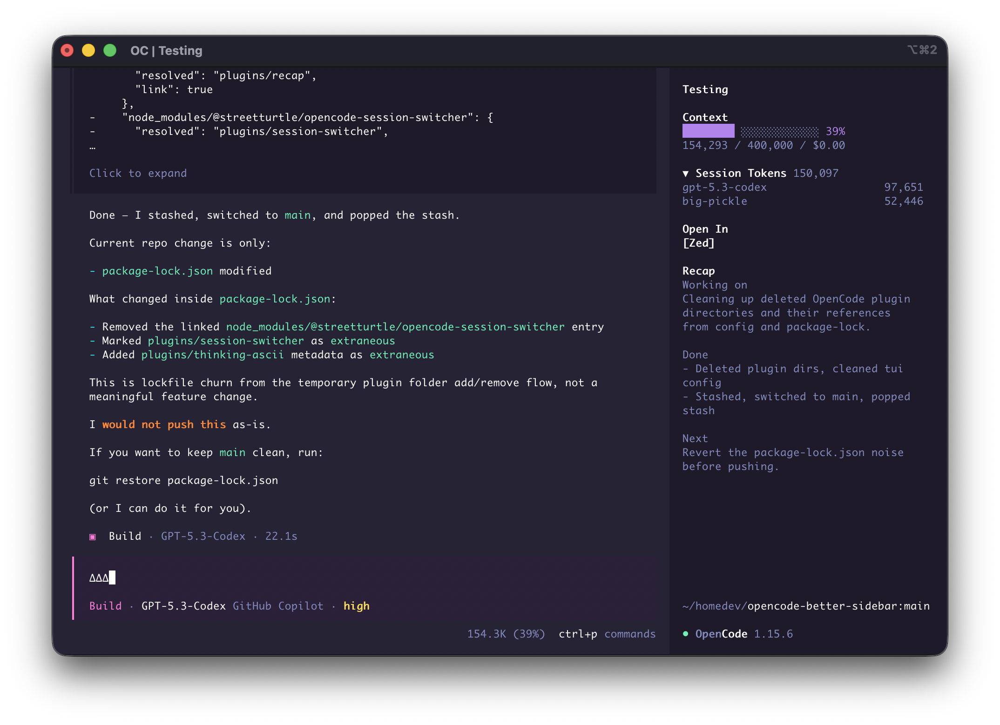

# opencode-better-sidebar

Small, focused OpenCode sidebar plugins that make daily coding sessions faster.

If this helps your workflow, please star the repo.

<p align="center">
  
</p>

## Install

[`@streetturtle/opencode-context-progress`](./plugins/context-progress),
[`@streetturtle/opencode-open-in`](./plugins/open-in), and
[`@streetturtle/opencode-recap`](./plugins/recap) 2.x target OpenCode 2:

```sh
opencode plugin add @streetturtle/opencode-context-progress
opencode plugin add @streetturtle/opencode-open-in
opencode plugin add @streetturtle/opencode-recap
```

The remaining plugins in this repo are still OpenCode 1 plugins (use the `@1` versions of
`context-progress`, `open-in`, and `recap` on OpenCode 1):

```sh
opencode plugin --global @streetturtle/opencode-session-tokens
```

or from OpenCode, press <kbd>ctrl</kbd>+<kbd>p</kbd> -> "Install Plugin" -> "@streetturtle/opencode-session-tokens"

## Plugin Pack

- [`@streetturtle/opencode-open-in`](./plugins/open-in) - quick buttons to open the current session folder in Zed, VS Code, or Cursor. (2.x = OpenCode 2)
- [`@streetturtle/opencode-context-progress`](./plugins/context-progress) - context usage progress bar with token usage, window limit, and spend. (2.x = OpenCode 2)
- [`@streetturtle/opencode-recap`](./plugins/recap) - one-click AI recap for the current session. (2.x = OpenCode 2)
- [`@streetturtle/opencode-session-tokens`](./plugins/session-tokens) - collapsible session token totals with per-model breakdown.
